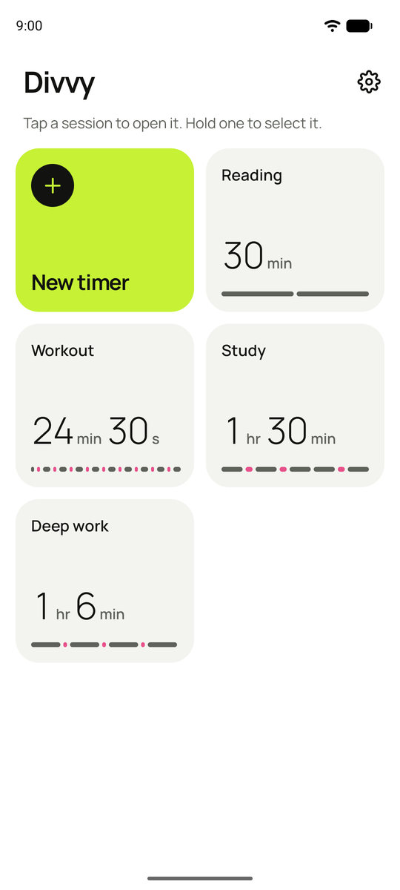
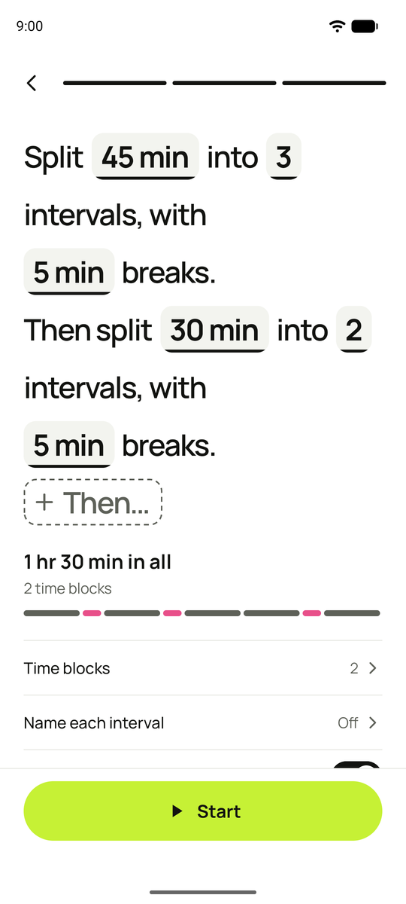
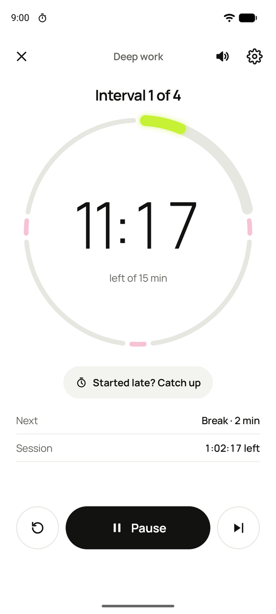
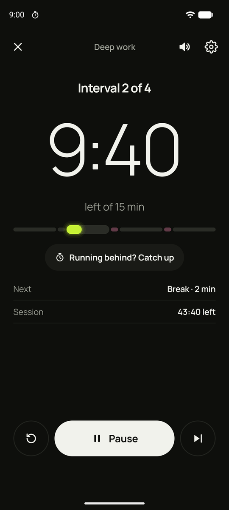
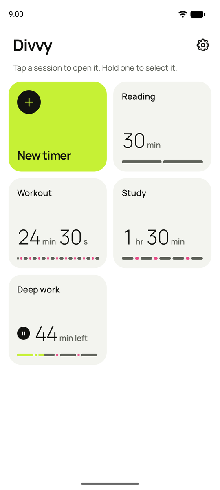
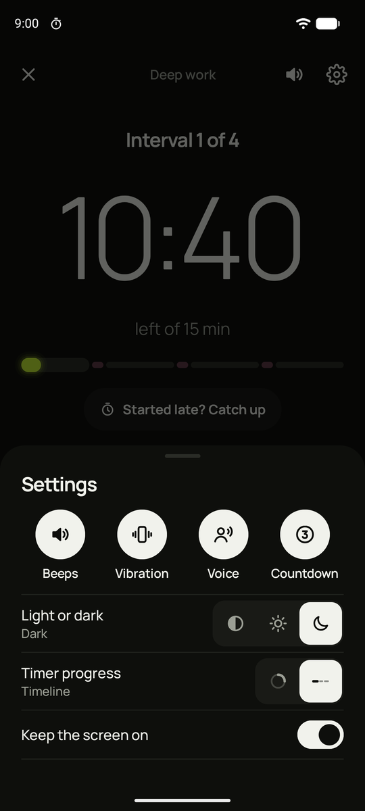

# Divvy: Interval Timer

**Set the time. Divvy does the maths.** An interval timer that works how you think.

Tell Divvy how long you have and how many parts you want, and it splits the time for you. One hour in four parts with two-minute breaks? That's one tap, not a calculator.

  
  
  
  

## Download

**[⬇ Get the latest version](https://github.com/prowhiz/divvy-releases/releases/latest)**

Divvy is for Android phones running Android 8.0 or newer. It isn't on the Play Store yet.

1. Open the link above on your phone.
2. Under **Assets**, tap the file ending in `.apk` to download it.
3. Open the downloaded file and tap **Install**. The first time, Android asks you to allow **Install unknown apps** for your browser or file manager. Allow it, then go back and tap Install.

After that, Divvy keeps itself up to date. When a new version comes out here, a card on the Home screen offers to install it. You can turn this off with **Check for updates** in Settings.

## What it does

- **Split a total into equal parts.** Pick how long you have and how many intervals you want. Divvy works out how long each one is.
- **Breaks your way.** Add breaks between intervals, either on top of your total or taken out of it.
- **Several time blocks in one session.** For example, 45 minutes in three parts, then 30 minutes in two. You can put a break between blocks too.
- **Set up in plain words.** Divvy asks one question per screen, then shows the whole session as a sentence you can tap to change.
- **Saved sessions.** Each session gets a name on its own and sits on the Home screen as a tile. Tap one to open it, hold to edit, drag to reorder.
- **Beeps, voice and vibration** at the end of each interval and break, with an optional "3, 2, 1" countdown. With headphones or a Bluetooth speaker connected, cues play there and mix in with your music.
- **Catch up.** Started late or fell behind? Divvy jumps to where you'd be if you'd started on time.
- **Pause for later.** Step away from a paused session and pick it up again from its tile, even after the phone restarts.
- **Ring or Timeline.** Watch your progress as a ring or a straight line, in light or dark.
- **Keeps going in the background.** The timer carries on with the screen off or the app closed, and the notification shows where you are.

  
  

## Your data

There's no account, no ads and no tracking. Your sessions stay on your phone. The only time Divvy goes online is to check this page for a new version, and you can turn that off.

## What's new

Each release lists its changes in plain words. See [all releases](https://github.com/prowhiz/divvy-releases/releases).

## Questions or problems

Found something that doesn't work right, or have an idea? [Open an issue](https://github.com/prowhiz/divvy-releases/issues).
